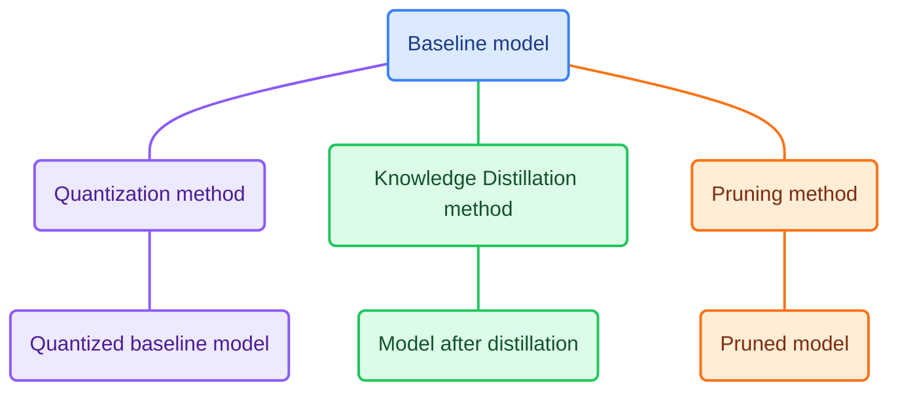

# Quantization, Pruning, Knowledge Distillation of Ukrainian LLM

Term project for "Artificial Intelligence" course, which explores quantization, pruning, and knowledge distillation to reduce the computational requirements of language models while preserving their performance on Ukrainian-language tasks.


## Comparison UI demo

The project includes a local web demo for exploring model compression techniques. The interface provides a home page, method cards, and a prompt screen for testing models. Knowledge distillation includes separate BERT and Qwen tabs, while pruning and quantization each have a Gemma tab. Users can enter a prompt to compare the outputs of the baseline and compressed models. 

Metrics results come from `results/demo_metrics.json` and remain fixed across prompts. Model weights are loaded from local directories specified in `config/default.yaml`, loaded after running notebook for each method:

| Method | Model | Baseline directory | Compressed directory |
|---|---|---|---|
| Distillation | bert-base-uncased-SST-2 | `models/bert-base-sst2-teacher` | `models/tiny-bert-best` |
| Distillation | Qwen | `models/qwen2-1.5b-teacher`| `models/gkd-qwen2-0.5b-xlsum` |
| Pruning | gemma-3-270m-it | `models/gemma-baseline` | `models/best_pruned_model` |
| Quantization | gemma-3-270m-it | `models/gemma-baseline` | `models/gemma-hqq-xlsum` |

For more information, see the `app/README.md`.

## Team

| Name                 | GitHub                                   | Role                                |
|----------------------|------------------------------------------|-------------------------------------|
| Iia Maharyta         | [@luftboud](https://github.com/luftboud) | Knowledge Distillation,  UI         |
| Vladyslav Danylyshyn | [@D-VLAD1](https://github.com/D-VLAD1)   | Pruning                             |
| Oksana Moskviak      | [@okqsna](https://github.com/okqsna)     | Data Exploration, Quantization      |

## Problem and motivation

Modern large language models (LLMs) require substantial memory and computational resources due to their large number of parameters, making them difficult to run locally and deploy on resource-constrained devices. Model compression through quantization, distillation, and pruning offers a promising way to address these challenges. This project aims to compare these methods, their variants, and their combinations to identify the approaches that achieve the best balance between model size, memory usage, inference speed, and performance, with a particular focus on Ukrainian-language tasks.

## Datasets

| Dataset | Purpose in the project |
|---|---|
| `mmlu_ukr` | Ukrainian multiple-choice questions for evaluating knowledge and reasoning across subjects. |
| `ifeval_ukr` | Ukrainian prompts with constraints for evaluating instruction following. |
| `wiki-instruction-dialogs` | Instruction–response data for exploring instruction-based training and evaluation. |
| Ukrainian XL-Sum | News articles paired with reference summaries for summarization experiments. |
| Ukrainian C4 | Text used for calibration in quantization experiments. |

For more information visit `data/README.md`.

## Approach



## Results

### Intermediate results
The results can be found in the notebooks corresponding to each compression technique in the `notebooks` directory
and in `results/demo_metrics.json` file.

##### Baseline models
| Model | Loss | ROUGE-L | Model size (MB) |
|---|---|---|---|
| Gemma-3-270m-it | 3.8468 | 0.0914 | 1072.395 |
| bert-base-uncased-SST-2 | | | |
| Qwen2-1.5B-Instruct | | | |

##### Compressed models
| Compression technique | Method | Baseline model | Loss | ROUGE-L | Model size (MB)|
|---|---|---|---|---|---|
| Quantization | Half-Quadratic Quantization | Gemma-3-270m-it | 3.8612 | 0.084 | 771.585 |
| Knowledge Distillation | Half-Quadratic Quantization | bert-base-uncased-SST-2 | |  | |
| Knowledge Distillation | Half-Quadratic Quantization | Qwen2-1.5B-Instruct |  |  |  |
| Pruning | Block Pruning | Gemma-3-270m-it |  |  | |

## Quick start

<!-- ```bash
git clone <repo-url> && cd wine-origin-classifier
make setup                          # creates .venv, installs deps, installs pre-commit hooks
make reproduce                      # data -> train -> evaluate; should print accuracy=0.9722 macro_f1=0.9710
source .venv/bin/activate           # everything past this point assumes the venv is active
streamlit run app/streamlit_app.py  # opens the demo at localhost:8501
``` -->

### Tools

<!-- This repo uses `pip` + `flake8` + `black` + `isort` because that's the lowest common denominator most students already know. Nothing about the course methodology requires exactly this — a `uv` + `ruff` setup (faster, less config) is a perfectly fine substitute, and what's graded is that your environment is reproducible and your code is consistently formatted, not which tool you used to get there. If you switch, it's about this much code:

```bash
uv venv && uv pip install -r requirements.txt -r requirements-dev.txt
ruff check . && ruff format --check .
``` -->

## Repository structure

```
.
├── src/model_origin/     # the package: config, data, models, evaluate, cli.py 
├── scripts/              # download_data.py, run_experiment.py
├── app/                  # the interactive Comparison UI (see app/README.md)
├── notebooks/             # 01-05, executed (see notebooks/README.md)
├── tests/                 # test_data.py, test_models.py, test_reproducibility.py
├── config/default.yaml    # every hyperparameter, path, and the seed — nothing hardcoded in src/
├── data/                  # raw data NOT committed; data/README.md (data card)
├── models/                # trained weights NOT committed; models/README.md 
├── results/               # demo_metrics.json/ — all committed, all small
├── docs/                  # proposal/, poster/, slides/, CONTRIBUTING.md, and this file's supporting docs
└── .github/workflows/     # lint.yml — one CI example, easy to extend (see its comments)
```

## Contributing

Work lands on `main` through a branch and a rebase pull request with one review. Branch names and hook setup: [`docs/CONTRIBUTING.md`](docs/CONTRIBUTING.md).

## AI usage

| Tool | Used for | How the result was checked |
|---|---|---|
| Cursor | Continuous Integration and code validation | Read line by line. |
| ChatGPT | Code validation, tutorials research, README.md templates  | Read line by line and cross-checked with Hugging Face documentation, personal blog of Phill Schmid. |

## Contribution statement

| Member | Contribution | Responsible for |
|---|---|---|
| Iia Maharyta | 1/3 | CI, UI, Knowledge Distillation |
| Vladyslav Danylyshyn | 1/3 | Repository, Pruning |
| Oksana Moskviak | 1/3 | Data exploration, Quantization |

All members agree with the above distribution.

## License and citation

| | License | Notes |
|---|---|---|
| Code (this repo) | MIT — see [`LICENSE`](LICENSE) | Free to reuse, including commercially |
| Data | See [`data/README.md`](data/README.md) | **Not MIT** — the dataset's own terms apply, independent of this repo's code license |
| Trained model | Inherits the data's terms + this repo's code license | See [`models/README.md`](models/README.md) |
| Text / poster / slides | CC BY 4.0 (recommended) | Attribute this repo if reused |

Citing this project: see [`CITATION.cff`](CITATION.cff) (GitHub renders a "Cite this repository" button from it automatically). Citing the underlying dataset: see [`data/README.md`](data/README.md).

## Acknowledgments

Built from [`ucu-ai-course/project-template`](https://github.com/ucu-ai-course/project-template). Thanks to the course instructors and our project mentor for feedback throughout the semester.
